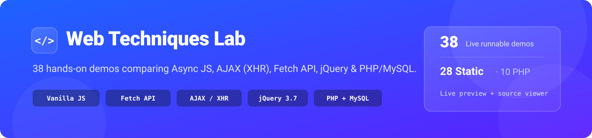
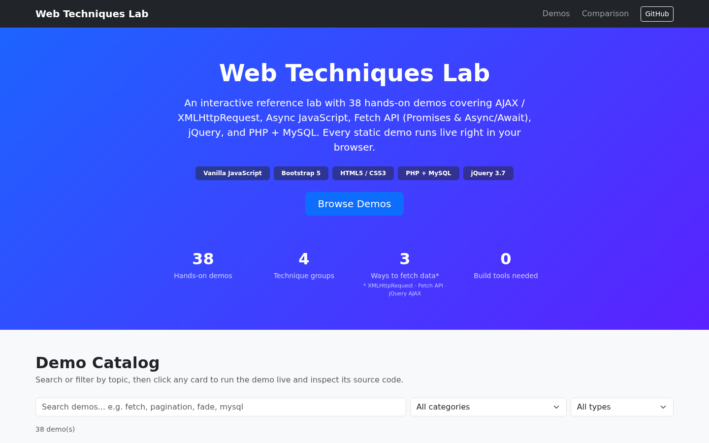
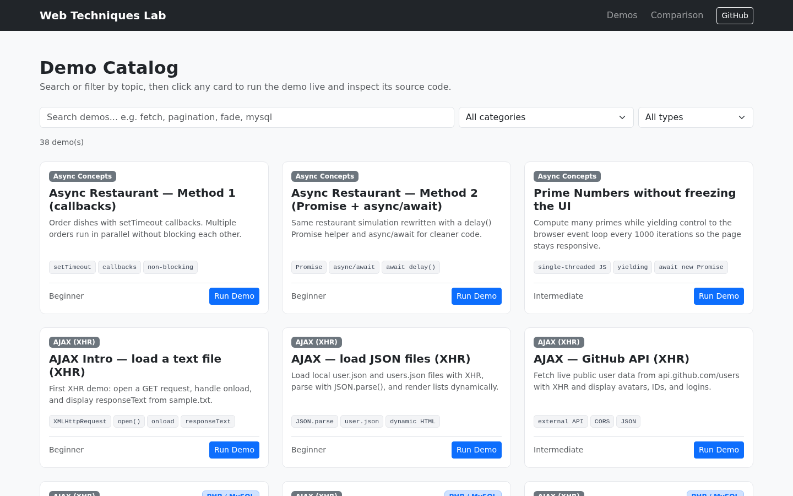
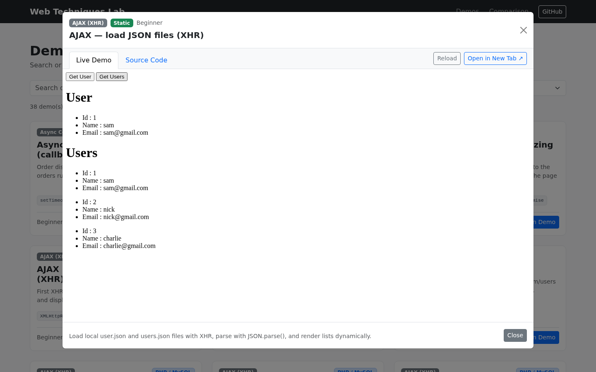
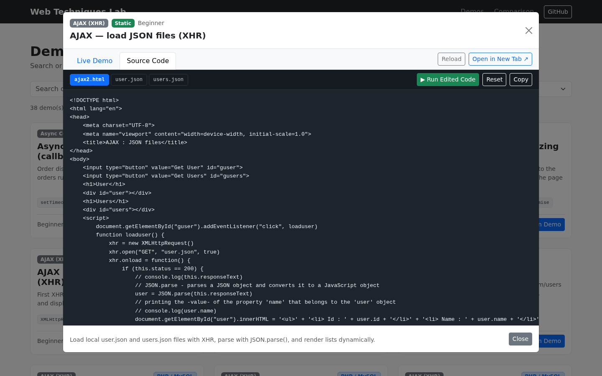
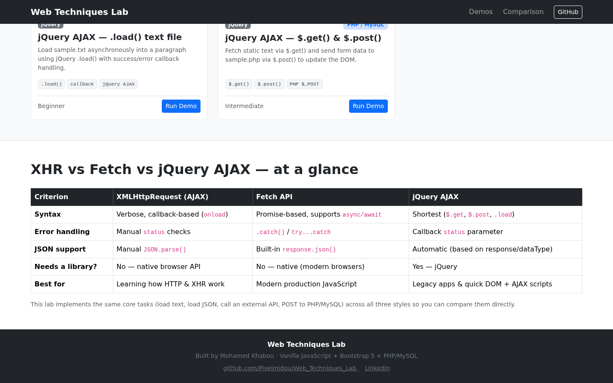

# Web Techniques Lab

### Async JS, AJAX, Fetch API, jQuery & PHP/MySQL — side by side.

An interactive reference lab with **38 hands-on demos** comparing classic and modern web techniques, built with vanilla JavaScript, Bootstrap 5, jQuery, and PHP/MySQL.

**[Live demo](https://weblab.great-site.net/)** · [Explore the screenshots](#screenshots) · [Run locally](#run-it-locally)

> **38 runnable demos** · **XHR vs Fetch vs jQuery** · **Live preview & editable source**

---

## The project

Web Techniques Lab brings together 38 focused web development demos into one searchable browser workspace. Instead of reading isolated code snippets, visitors can filter by topic or runtime, launch any demo inside a live preview modal, and switch tabs to inspect—or edit and re-run—the underlying HTML, CSS, JavaScript, JSON, and PHP files.

The lab deliberately implements the same core workflows (loading text files, parsing local JSON, calling public REST APIs, and submitting forms to PHP/MySQL) across **XMLHttpRequest**, the **Fetch API** (both Promises and `async/await`), and **jQuery AJAX** so the trade-offs between all three approaches can be compared directly.

## Screenshots

A quick look at the main views: the landing hero, the searchable demo catalog, the live demo modal, the source code editor, and the comparison table.

### Landing overview


### Demo catalog & filters


### Live demo preview


### Multi-file source code editor


### Technique comparison


## Try the live demo

Open **[Web Techniques Lab](https://weblab.great-site.net/)**:

- Use the **search bar**, **category dropdown**, and **type filter** (`Static only` / `PHP / MySQL`) to narrow down the 38 demos.
- Click **Run Demo** on any card to test it live in the modal or open it standalone in a new tab.
- Switch to the **Source Code** tab to read every file belonging to that demo (including JSON data files and PHP backend scripts). For static demos, you can modify the code directly and click **Run Edited Code** to see your changes immediately.

## Technique groups

| Group | Demos | What it covers |
|---|---|---|
| **Async Concepts** | 3 static | Non-blocking prime computation (yielding to the event loop), `setTimeout` callbacks vs Promise `delay()` with `async/await`. |
| **AJAX (XHR)** | 3 static · 7 PHP/MySQL | Text files, local JSON, GitHub public API, XHR GET/POST to PHP, MySQL lists, department filtering, Load More, and pagination. |
| **Fetch API** | 11 static · 2 PHP/MySQL | Promise syntax, text & JSON loading, JSONPlaceholder GET/POST, nested & sequential API calls, PHP POST, and full MySQL CRUD + sorting. |
| **jQuery** | 11 static · 1 PHP | Selectors, `.on()` events, hide/show, toggle, fading, sliding, animations, jQuery UI draggable & accordion, DOM management, custom accordion showcase, `.load()`, `$.get()`, and `$.post()`. |

## XHR vs Fetch vs jQuery AJAX

| Criterion | XMLHttpRequest (AJAX) | Fetch API | jQuery AJAX |
|---|---|---|---|
| **Syntax** | Verbose, callback-based (`onload`) | Promise-based, supports `async/await` | Shortest (`$.get`, `$.post`, `.load`) |
| **Error handling** | Manual `status` checks | `.catch()` / `try...catch` | Callback `status` parameter |
| **JSON support** | Manual `JSON.parse()` | Built-in `response.json()` | Automatic (based on response/dataType) |
| **Needs a library?** | No — native browser API | No — native (modern browsers) | Yes — jQuery |
| **Best for** | Learning how HTTP & XHR work | Modern production JavaScript | Legacy apps & quick DOM + AJAX scripts |

## Built with

| Part | Tools | Role |
|---|---|---|
| Interface | HTML5, CSS3, Bootstrap 5 | Responsive hero, filterable card grid, comparison table, and preview modal. |
| Lab controller | Vanilla JavaScript (ES6+, Fetch API) | Dynamic catalog rendering, search/filters, file caching, and live iframe execution. |
| Demo libraries | jQuery 3.7, jQuery UI 1.13 | DOM manipulation, animations, interactive widgets, and jQuery AJAX demos. |
| Backend & data | PHP 8, MySQL / MySQLi | Prepared-statement queries, server-side sorting/pagination, CRUD, and safe source reading. |

## Implementation notes

- **Zero build tools.** The entire lab runs directly from plain HTML, CSS, JavaScript, and PHP files—no bundler, transpiler, or framework build step is required.
- **Editable live sandbox for static demos.** Static demos load into an `iframe` via `srcdoc` with an injected `<base href>` tag so relative assets like `sample.txt`, `user.json`, and `users.json` keep resolving even after editing the code.
- **Safe PHP source inspection (`source.php`).** When hosted on a PHP server, requesting `.php` files directly executes them instead of returning their source. `source.php` reads raw source text using `realpath()` to restrict access strictly to `demos/` (preventing path traversal) and automatically redacts database credentials whenever `db.php` is viewed.
- **Single-database MySQL setup.** All 9 MySQL PHP scripts share one connection file (`demos/db.php`) and one schema (`sql/schema_single_db.sql`), using MySQLi prepared statements and an explicit column whitelist for dynamic `ORDER BY` sorting.

## Run it locally

### Static demos only (no PHP or MySQL needed)

Serve the project folder with any local HTTP server (required so `fetch()` can load demo files):

```bash
python3 -m http.server 8000
```

Open **http://localhost:8000** in your browser. All 28 static demos run immediately; PHP demos remain inspectable in the **Source Code** tab.

### Full lab with PHP & MySQL (XAMPP / Laragon)

1. Copy the project folder into your local web root (for example `C:\xampp\htdocs\web-techniques-lab`).
2. Start **Apache** and **MySQL** in XAMPP / Laragon.
3. Open **phpMyAdmin**, create a database named `web_techniques_lab`, and import `sql/schema_single_db.sql` (creates `abonne`, `service`, `employe`, and `eleve` with sample records).
4. Check `demos/db.php` and set your local credentials:

```php
$DB_HOST = "localhost";
$DB_USER = "root";
$DB_PASS = "";
$DB_NAME = "web_techniques_lab";
```

5. In `demos.js`, enable same-server PHP execution:

```js
const PHP_HOST_URL = "";
const SAME_SERVER_PHP = true;
```

6. Visit **http://localhost/web-techniques-lab/**.

### Common local issues

- **Demo code fails to load when double-clicking `index.html`:** browsers block `fetch()` over `file://`; always serve the folder through `http://localhost`.
- **Database connection failed:** confirm MySQL is running, `sql/schema_single_db.sql` has been imported, and the 4 values in `demos/db.php` match your environment.
- **PHP tabs show executed output instead of source code:** verify `source.php` sits next to `index.html` and `SAME_SERVER_PHP = true` is set in `demos.js`.

## Repository map

```text
Web_Techniques_Lab/
├── index.html                           Landing page, catalog, comparison table, and modal
├── style.css                            Custom styles on top of Bootstrap 5
├── demos.js                             Catalog metadata (38 demos) and PHP host config
├── app.js                               Filtering, modal controller, and live code runner
├── source.php                           Safe raw source viewer for PHP files
├── sql/
│   └── schema_single_db.sql             Single-database schema and seed data
├── screenshots/                         README banner and application screenshots
├── demos/
│   ├── db.php                           Shared MySQLi connection (keep real credentials out of Git)
│   ├── Async_Concepts/                  Async prime numbers and restaurant timers
│   ├── AJAX/                            XHR text, JSON, GitHub API, PHP, and MySQL demos
│   ├── fetch_api/                       Promises, text/JSON/API fetches, PHP POST, and CRUD
│   └── jQuery/                          Selectors, events, effects, UI, DOM, and jQuery AJAX
└── README.md                            Project overview, screenshots, and setup guide
```

## Author

**Mohamed Khabou**  
Computer Science Student — Faculté des Sciences de Sfax (FSS), Sfax, Tunisia  
[GitHub](https://github.com/Pixelmidou) · [LinkedIn](https://linkedin.com/in/mohamedkhabou)
